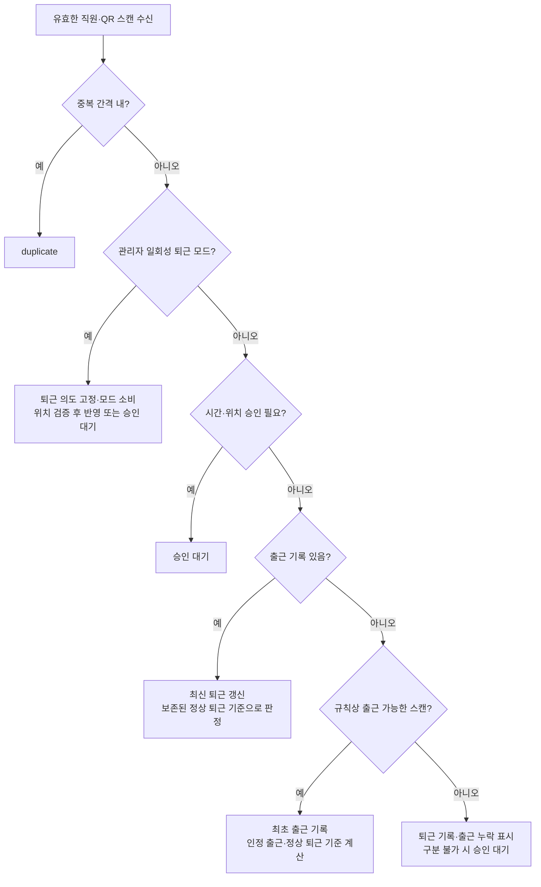
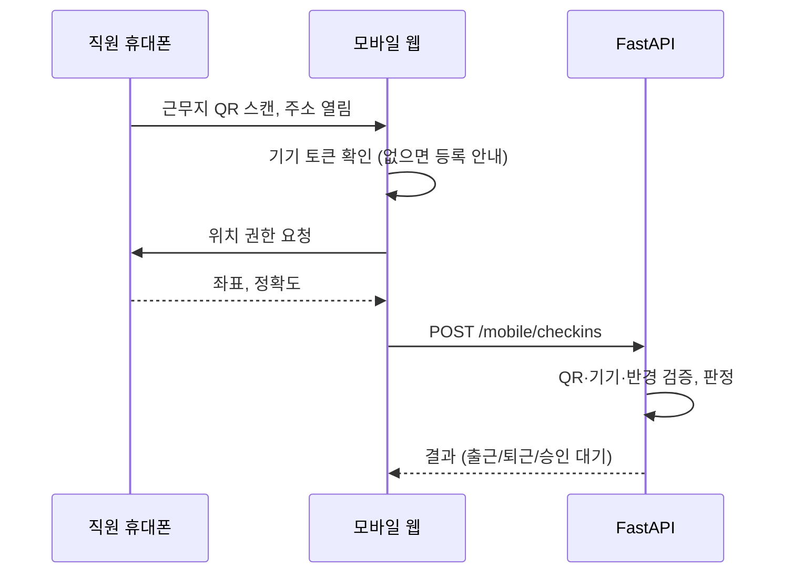

# 출퇴근 기록 패키지 설계 문서

Sep 24, 2026 · @Youngwon Kim

구현 현황과 API 구체화 사항은 [implementation.md](implementation.md), 실행 방법은 [README.md](../README.md)를 참고한다.

> 2026-10-01 / 0.2.0 우선 적용: 아래 초기 범위 중 스캐너의 공통 연결은 패키지에 포함합니다. 호스트별 장치 배치·인증·운영 설정은 계속 호스트 책임입니다. 사무실 직원 QR은 기본적으로 60초 서버 서명 회전 QR이며 정적 QR은 명시적 legacy 모드에만 허용합니다. 기존 근무지 모바일 QR과는 별개입니다.

## 1. 개요

사무실 QR 스캐너와 외부 근무자 휴대폰으로 출퇴근을 기록하는 기능을, 다른 프로젝트에 설치해 붙일 수 있는 패키지로 만든다. 백엔드는 FastAPI에 붙는 Python 패키지, 프론트엔드는 React 컴포넌트 패키지로 제공한다.

**범위**

- 스캔 기록: 입력 장치와 무관하게 직원 QR 값을 받아 판정·기록하는 record\_scan() 함수
- 외부 근무: 현장에 둔 근무지 QR을 직원 휴대폰으로 스캔, GPS로 위치 확인. 모바일 체크 화면은 선택 설치하는 기본 화면과 헤드리스 훅으로 제공하고 단계별로 커스텀할 수 있다
- 관리 API: 현황 조회, 승인, 기록 수정, 직원·근무지·기기 관리, 근무 규칙 설정, CSV 내보내기 (화면은 호스트가 구현)

**범위 밖 (호스트 프로젝트 책임)**

- 로그인과 사용자 계정, 관리자 권한 판단, 관리자 화면(UI)
- 사무실 스캐너·Mac Mini 연동. 이 프로젝트의 개발 PC에 직접 붙이는 전용 구성이다 (8장 참고)
- 알림 발송 채널(알림톡, 문자, 슬랙 등)
- 서버 호스팅, 도메인, HTTPS 인증서

**기술 스택**

| 영역 | 기술 |
| --- | --- |
| 백엔드 | Python, FastAPI, SQLAlchemy 2.x, Alembic |
| 프론트엔드 | TypeScript API 클라이언트, React 모바일 체크 화면(선택). 관리자 화면은 호스트가 구현 |
| 스캐너 에이전트 | 패키지 범위 밖. 이 프로젝트에서 Mac Mini에 직접 연동 (8장) |
| 지도 | 패키지 의존성 없음. 호스트 관리자 화면에서 카카오맵 권장 (10장) |

**용어**

| 용어 | 뜻 |
| --- | --- |
| 호스트 프로젝트 | 이 패키지를 설치해 쓰는 프로젝트 |
| 스캔 | QR이 한 번 읽힌 원본 이벤트. 수정하지 않는다 |
| 근태 기록 | 직원 1명의 하루 출근·퇴근 결과. 스캔으로 만들어지고 관리자가 고칠 수 있다 |
| 승인 대기 | 자동 판정하지 않고 관리자 결정을 기다리는 스캔 |
| 에이전트 | (이 프로젝트 전용) Mac Mini에서 스캐너 값을 읽어 record\_scan()에 넘기는 코드 |
| 근무지 | 외부 근무 장소. 좌표와 허용 반경, 근무지 QR을 가진다 |

## 2. 출퇴근 판정 규칙

모든 판정은 서버가 서버 시각으로, 서울 시간(Asia/Seoul, UTC+9, 서머타임 없음) 기준으로 한다. 클라이언트와 에이전트는 시각을 정하지 않는다.

**하루 기록 집계 (2026-09-28 확정)**

- 출근은 그날 출근으로 인정되는 유효 스캔 중 가장 이른 실제 시각을 사용하고, 그 시각을 규칙의 출근 구간에 맞춰 `credited_in_at`을 계산한다.
- 예정 퇴근 시각 이후의 유효 스캔 중 가장 늦은 시각을 퇴근으로 사용한다. 예정 퇴근 전 재스캔은 `already_in`으로 원장을 변경하지 않는다. 활성 일회성 퇴근 지정이 있는 경우만 `early_out`으로 처리한다. 중복·재스캔도 원본 로그에 추가하며 이미 기록한 스캔을 덮어쓰지 않는다.
- 출근 스캔 하나만 있으면 출근만 기록하고 퇴근은 비워 둔다. 하나의 스캔을 출근과 퇴근에 동시에 쓰지 않는다. 당일 진행 중인 최신 퇴근 값은 이후 스캔에 따라 바뀔 수 있다.
- 중복 간격 내 스캔, 거부된 스캔, 승인 대기·무시된 스캔은 자동 집계 대상에서 제외한다. 대기 스캔은 승인 후 지정된 출근·퇴근 역할로 반영한다. 수동 수정·승인된 값은 자동 집계로 덮어쓰지 않는다.
- 출근 없이 퇴근으로 판정·승인된 스캔은 `out_no_in`과 출근 누락을 표시한다. 출근 시각이나 인정 출근을 추정해서 채우지 않는다. `elapsed` 방식에서는 정상 퇴근 기준도 계산하지 않는다.
- 첫 스캔이 출근인지 출근 누락 퇴근인지는 적용 규칙의 시간 범위 또는 관리자 승인으로 구분한다. `elapsed` 방식의 출근 없는 퇴근 구분 경계는 별도 운영 설정으로 정하며, 출근 시각 없이 9시간을 역산하지 않는다.

**관리자 지정 퇴근 모드 (급한 조퇴·휴가 예외)**

- 일반 스캔은 위의 가장 이른 출근·가장 늦은 퇴근 집계를 유지한다. 모든 QR을 출근용·퇴근용으로 상시 분리하거나 전체 스캐너를 퇴근 모드로 바꾸지 않는다.
- 출근 후 급한 조퇴·휴가가 필요하면 관리자가 대상 직원의 다음 유효 QR 스캔을 퇴근으로 처리하도록 일회성 모드를 지정한다. 지정할 때 사유, 구분 라벨(조퇴·휴가·기타 등), 만료 시각을 함께 저장한다.
- 예: `09:00` 출근 → 관리자가 조퇴 모드 지정 → 직원이 `09:20`에 QR 스캔 → 실제 퇴근 `09:20` 및 조퇴 라벨을 기록한다. 관리자의 모드 지정만으로 퇴근을 기록하지 않는다.
- 모드는 지정 직원에게만 적용하며 한 번의 유효 스캔 처리와 동시에 소비한다. 만료·취소된 모드는 적용하지 않고, 유효하지 않거나 중복으로 제외된 스캔으로는 소비하지 않는다. 다른 직원의 스캔에는 영향을 주지 않는다.
- 지정 모드가 있는 유효 스캔은 일반 시간대 추론보다 우선해 퇴근 의도로 처리한다. 직원·QR 인증과 위치 검증은 생략하지 않는다. 위치 검증으로 승인 대기가 되면 모드와 퇴근 의도를 해당 스캔에 연결하고 모드를 소비하며, 관리자 승인 후 근태에 반영한다.
- 실제 퇴근 시각과 조기·정상 퇴근 판정은 보존하고 관리자가 지정한 휴가·조퇴 라벨을 별도로 남긴다. 출근이 없으면 출근 누락도 표시한다. 휴가 잔여일 차감이나 별도 휴가 신청 시스템은 이 기능에 포함하지 않는다.
- 이 경로로 확정한 퇴근은 관리자 지정 기록으로 보호한다. 이후 일반 스캔으로 자동 덮어쓰지 않고, 복귀·재근무 등으로 바꿔야 하면 관리자가 명시적으로 수정한다.
- 지정·취소·만료·소비와 실제 스캔의 연결을 감사 이력으로 남긴다. 동시에 두 요청이 들어와도 모드 소비와 근태 반영은 한 트랜잭션에서 한 번만 처리한다.

**시간대별 판정** (근무일 = 스캔 시각의 서울 날짜. 괄호 안 시각은 기본값이고, 실제 경계는 직원에게 적용되는 근무 규칙에서 읽는다)

아래 표는 고정 시업 시각을 사용하는 기본 규칙이다. 테스트 환경의 구간별 인정 출근 시각은 아래 ‘테스트 환경의 출근 시간 요구사항’을 따른다. 구간 방식에는 아래의 단일 시업 시각·11:00 마감을 그대로 적용하지 않는다.

| 스캔 시각 | 그날 출근 기록 없음 | 그날 출근 기록 있음 |
| --- | --- | --- |
| 출근 시작 전 (00:00–07:59) | 승인 대기 (`early_hours`) | 승인 대기 (`early_hours`) |
| 출근 시작 \~ 시업 시각 (08:00–09:00) | 출근 (`normal`) | 가장 이른 출근 유지, 이후 유효 스캔은 최신 퇴근으로 갱신 (`early`) |
| 시업 시각 이후 \~ 출근 마감 전 (09:01–10:59) | 지각 (`tardy`) | 가장 이른 출근 유지, 이후 유효 스캔은 최신 퇴근으로 갱신 (`early`) |
| 출근 마감 \~ 퇴근 시작 전 (11:00–17:59) | 늦은 출근 (`late`), 반차 후보 | 조기 퇴근 (`early`) |
| 퇴근 시작 \~ 자정 (18:00–23:59) | 퇴근, 출근 기록 없음 표시 | 퇴근 (`normal`), 가장 늦은 스캔으로 갱신 |

지각(`tardy`)은 근로계약서·취업규칙의 시업 시각을 넘긴 출근이고, 늦은 출근(`late`)은 출근 마감을 넘겨 오전반차일 가능성이 있는 출근이다. 시업 시각을 설정하지 않은 규칙은 지각을 판정하지 않는다.

**반차·조퇴**

- 적용 규칙에 따른 늦은 출근과 정상 퇴근 기준보다 이른 최신 퇴근을 반차·조퇴 검토 대상으로 표시한다. 당일 추가 스캔으로 정상 퇴근이 되면 조기 퇴근 표시는 갱신한다.
- 승인된 반차인지 무단 조퇴인지는 시스템이 판단하지 않는다. 관리자가 근태 기록에 구분 라벨을 붙인다.
- 구분 라벨: 오전반차, 오후반차, 조퇴, 외근, 휴가, 결근, 기타

**승인 대기 처리** (시간 범위 밖 또는 위치 검증 등으로 대기 중인 스캔)

- 이날 출근으로 인정: 그날 출근 시각을 해당 스캔으로 설정 (기존 출근보다 이를 때)
- 이날 퇴근으로 인정: 그날 퇴근 시각을 해당 스캔으로 설정 (기존 퇴근보다 늦을 때)
- 전날 퇴근으로 인정: 전날 근태 기록의 퇴근 시각으로 설정. 자정을 넘긴 야근 처리용
- 무시: 기록에 반영하지 않음
- 실제 스캔은 보존하고 승인·수정 이력을 남긴다. 수동 수정·승인된 값을 다른 승인 요청이 자동으로 덮어쓰지 않으며, 충돌 시 409로 응답하고 관리자가 명시적으로 수정한다.

**기타 규칙**

- 중복 방지: 같은 직원이 중복 간격(기본 60초) 안에 다시 스캔하면 `duplicate`로 응답하고 기록하지 않는다.
- 외부 근무 체크가 근무지 반경 밖이면 거부하지 않고 승인 대기(`outside_geofence`)로 보낸다.



판정 함수는 DB와 분리된 순수 함수로 `attendance-core`에 둔다(4장).

**근무 규칙 (회사·그룹·직원별 설정)**

회사마다 출근 시간이 다르므로 판정 경계는 코드에 고정하지 않는다. 설정 파일은 초기값을 등록하는 용도이며, 운영 중에는 DB의 근무 규칙을 사용한다. 파일과 DB는 동일한 규칙 스키마를 사용하며, 재시작이나 파일 변경으로 기존 DB 설정을 덮어쓰지 않는다. 관리 API나 호스트 코드로 규칙을 만들고 날짜별 예외, 직원, 팀·포지션, 근무지, 회사에 배정한다.

**테스트 환경의 출근 시간 요구사항 (2026-09-28 추가)**

- 일반 출근 시간은 오전 09:00부터 11:00까지 30분 간격이다: `09:00`, `09:30`, `10:00`, `10:30`, `11:00`.
- 직원별로 위 시각 하나를 미리 지정하는 방식이 아니라, 실제 스캔 시각을 해당 구간의 인정 출근 시각에 맞춘다. `09:10`까지는 `09:00` 출근으로 인정하고 그 이후는 다음 `09:30` 출근 구간으로 넘긴다.
- 각 출근 구간에 10분의 인정 여유를 동일하게 적용한다. ‘몇 시 몇 분까지’는 해당 분 전체를 포함한다. 예를 들어 `09:11:00` 미만까지 `09:00` 출근으로 인정한다.

| 실제 스캔 시각 (서울 시간, 분 단위) | 인정 출근 시각 |
| --- | --- |
| 출근 인정 시작부터 09:10까지 | 09:00 |
| 09:11~09:40 | 09:30 |
| 09:41~10:10 | 10:00 |
| 10:11~10:40 | 10:30 |
| 10:41~11:10 | 11:00 |

- 출근 구간 목록과 인정 여유(테스트 환경은 10분)는 DB 또는 설정 파일에서 변경할 수 있게 한다. 첫 구간의 출근 인정 시작과 마지막 구간 마감 후 처리는 별도로 정한다. `11:10` 이후를 임의로 `11:30` 출근으로 확장하지 않는다.
- 실제 스캔 시각과 인정 출근 시각을 구분해 보존한다. 예를 들어 실제 `09:08` 스캔은 그대로 남기고 인정 출근 시각은 `09:00`으로 저장한다. 원본 시각을 덮어쓰지 않으며, 중복 방지는 실제 스캔 시각으로 계산한다.
- 데이터 모델과 API에 인정 출근 시각 `credited_in_at`과 정상 퇴근 기준 `expected_out_at`을 명시하고 구간·여유 설정도 규칙 스냅샷에 포함한다. `in_at`은 실제 출근 시각(관리자 정정 가능), `att_scans.scanned_at`은 변경하지 않는 원본 시각이다.
- 영상팀의 오후 `13:00` 출근은 보고된 특정 날짜에만 적용한다. 보고된 대상 직원과 날짜에 예외 규칙을 등록하고, 다른 날짜에는 평소 규칙을 적용한다. 회사 공통의 `11:00` 경계만으로 늦은 출근 또는 반차 후보로 판단하면 안 된다. 보고 수단 자체는 호스트가 담당한다.
- 출근 시각뿐 아니라 출근 인정 시작, 지각 경계, 늦은 출근 시작, 퇴근 계산 방식도 적용 규칙에서 읽는다. 영상팀에 동일한 9시간 규칙을 배정하면 `13:00` 인정 출근의 정상 퇴근은 `22:00`이며, 별도 규칙으로 변경할 수 있다.
- 본문의 `08:00/11:00/18:00`은 기본 규칙 예시이며, 테스트 환경의 확정된 운영 시간표가 아니다.

**구현 전 핵심 결정 (2026-09-28 확정)**

1. **설정 저장·적용:** 파일은 초기값, DB는 운영 설정으로 사용한다. 변경 시 새 버전과 적용일을 저장하고 과거 기록의 스냅샷을 보존한다.
2. **규칙 배정:** 날짜별 예외 → 직원 → 팀·포지션 → 회사 기본을 기본 우선순위로 한다. 외부 근무지 규칙은 팀·포지션과 회사 기본 사이에 적용한다. 배정에도 적용 기간을 보존한다.
3. **출근 구간 경계:** 구간 목록과 인정 여유는 설정값이다. 마감 분 전체를 포함하며 실제 스캔과 인정 출근을 분리한다. 첫 구간 전·마지막 구간 후 정책도 설정으로 분리한다.
4. **퇴근 판정:** 테스트 장소는 인정 출근 시각에서 9시간 뒤를 정상 퇴근 시작으로 한다. DB의 `checkout_mode=elapsed`, `checkout_offset_minutes=540`으로 관리하며 변경 가능하다. 이 값은 휴게시간을 포함한 경과 시간이며 실제 유급 근로시간을 의미하지 않는다. 다른 회사는 `checkout_mode=fixed`와 `check_out_start`로 고정 퇴근을 선택할 수 있다.
5. **승인·수정:** 당일 출근·당일 퇴근·전날 퇴근·무시를 지원한다. 실제 스캔은 보존하고 인정 시각 변경과 승인 이력을 남기며, 수동 수정·승인 기록은 자동 재판정에서 제외한다.

| 인정 출근 시각 | 정상 퇴근 시작 (테스트 장소, 540분 설정) |
| --- | --- |
| 09:00 | 18:00 |
| 09:30 | 18:30 |
| 10:00 | 19:00 |
| 10:30 | 19:30 |
| 11:00 | 20:00 |

- 퇴근 기준은 실제 스캔 시각이 아닌 인정 출근 시각으로 계산한다. `09:08` 스캔 → `09:00` 인정 → `18:00` 정상 퇴근이다.
- 계산한 정상 퇴근 시작보다 이른 퇴근은 조기 퇴근, 해당 시각부터는 정상 퇴근이다. 계산 결과와 사용한 설정을 그날 기록에 보존한다.
- 근무 중 설정이 바뀌어도 이미 만들어진 그날 기록은 보존된 규칙을 사용한다. 관리자 재판정·수정 시에만 감사 이력과 함께 갱신한다.
- 남은 운영값: 첫 구간의 출근 인정 시작, 마지막 구간 이후 처리 정책, 출근 없는 퇴근을 구분할 시간 경계, 영상팀 예외의 인정 여유는 설정으로 지정한다. 영상팀 적용 날짜는 보고에 따라 등록하며 일반 시간표에 영상팀 구간을 자동으로 합치지 않는다.

| 항목 | 설명 | 기본값 |
| --- | --- | --- |
| `check_in_start` | 출근 인정 시작. 이보다 이른 스캔은 승인 대기 | 08:00 |
| `work_start` | 시업 시각. 이 시각을 넘긴 출근은 지각. 근로계약서·취업규칙의 시업 시각과 같게 설정 | 없음 (지각 판정 안 함) |
| `check_in_end` | 출근 마감. 이후 첫 스캔은 늦은 출근(반차 후보) | 11:00 |
| `check_out_start` | 퇴근 인정 시작. 이보다 이른 퇴근은 조기 퇴근 | 18:00 |
| `check_in_slots` | 구간 방식에서 인정할 출근 시각 목록 | 없음 (테스트 장소: 09:00~11:00, 30분 간격) |
| `slot_grace_minutes` | 각 구간 마감에 더할 인정 여유. 마감 분 전체 포함 | 테스트 장소: 10 |
| `checkout_mode` | `fixed`: 고정 퇴근, `elapsed`: 인정 출근에서 경과 시간 계산 | `fixed` (테스트 장소: `elapsed`) |
| `checkout_offset_minutes` | `elapsed`일 때 정상 퇴근까지의 경과 분. 휴게 포함 | 테스트 장소: 540 |
| `dedup_seconds` | 중복 스캔 무시 간격 | 60 |
| `effective_from` | 적용 시작일 | 등록일 |

시업 시각은 회사 규정과 반드시 맞춘다. 시스템이 "출근"으로 표시한 기록을 회사가 지각으로 처리하면 기록과 규정이 충돌해 분쟁 근거가 약해진다.

**적용 우선순위** (위가 먼저)

1. 해당 직원·날짜에 지정한 예외 규칙
2. 직원에게 지정한 규칙
3. 직원의 팀·포지션에 지정한 규칙 (동일 날짜에 하나의 유효 배정)
4. 외부 체크일 때 그 근무지에 지정한 규칙
5. 회사(테넌트) 기본 규칙
6. `AttendanceConfig` 초기 기본값. 해당 테넌트에 DB 규칙이 없을 때만 쓴다

**규칙이 바뀔 때**

- 새 규칙은 `effective_from` 날짜부터 적용하고, 그 전 날짜는 이전 규칙으로 판정한다.
- 판정에 쓴 규칙 ID와 경계 값을 근태 기록에 스냅샷으로 남긴다. 규칙을 고쳐도 지난 기록은 바뀌지 않는다.
- 지난 기간에 새 규칙을 적용하려면 관리자가 기간을 지정해 재판정을 요청한다(`POST /work-rules/{id}/rejudge`). 관리자가 수동 수정·승인한 기록은 재판정하지 않는다.
- 고정 출퇴근 규칙 저장 시 검증: `check_in_start` ≤ work\_start < `check_in_end` ≤ `check_out_start` (`work_start`가 없으면 해당 비교 생략).
- 구간 방식은 구간의 정렬·중복, 출근 인정 시작, 음수가 아닌 인정 여유를 검증한다. `elapsed`는 양수인 경과 분이 필수이며 각 구간의 계산된 퇴근 시각을 검증한다. 자정을 넘는 교대 근무는 아직 지원하지 않는다(12장).

## 3. 시스템 구성

기록 경로는 둘이다. 사무실에서는 직원 QR을 기계가 읽어 "누구인지"를 QR이 증명하고, 외부에서는 근무지 QR을 직원 휴대폰이 읽어 "누구인지"는 등록된 휴대폰이, "어디인지"는 QR과 GPS가 증명한다.

```mermaid
flowchart LR
  S[QR 스캐너<br/>USB-COM] --> A[Mac Mini 개발 PC<br/>직접 연동, 범위 밖]
  A -->|record_scan()| API[FastAPI<br/>attendance 라우터]
  M[직원 휴대폰<br/>모바일 웹] -->|POST /mobile/checkins| API
  W[호스트 관리자 화면] -->|조회·수정| API
  API --> DB[(호스트 DB)]
  API -->|이벤트 훅| N[호스트 알림<br/>알림톡 등]
```

| 구성요소 | 인증 방식 | 역할 |
| --- | --- | --- |
| 사무실 스캐너 (Mac Mini) | 해당 없음 (호스트 내부 호출) | 패키지 범위 밖. 이 프로젝트에서 스캐너를 직접 연결해 record\_scan() 호출. 모니터 없음 (8장) |
| 직원 모바일 웹 | 휴대폰별 기기 토큰 (초대 링크로 1회 등록) | 근무지 QR 스캔 후 열리는 체크 화면. 기본 화면(선택 설치)을 그대로 쓰거나 커스텀, 또는 훅만 써서 호스트가 직접 구현 (9장) |
| 관리자 웹 | 호스트 프로젝트의 로그인 | 호스트가 구현. 패키지의 관리 API로 현황, 승인, 수정, 직원·근무지·기기 관리 |
| 현장 QR 표시 화면 (선택) | 기기 토큰 | 30초마다 바뀌는 근무지 QR 표시 |

**모니터 없는 사무실 스캔의 피드백**

스캐너의 삑 소리는 QR을 읽었다는 뜻일 뿐 서버 기록 성공을 뜻하지 않는다. 등록 안 된 QR, 네트워크 오류, 조기 퇴근 판정을 직원이 알 수 있도록, 기록 결과를 `on_recorded` 훅으로 호스트에 넘겨 직원에게 알림을 보낸다. 알림 채널은 호스트가 정한다.

## 4. 패키지 구조

한 저장소(모노레포)에 Python 패키지 3개, npm 패키지 2개를 둔다. 관리자 화면은 호스트마다 디자인, 라우팅, 권한 체계가 달라 넣지 않는다. 사무실 스캐너 연동도 이 프로젝트의 Mac Mini에 붙는 전용 구성이라 넣지 않고, 패키지는 `record_scan()`만 제공한다(8장). 직원 모바일 체크 화면만 QR 주소로 바로 열려야 하므로 선택 설치하는 기본 화면으로 제공하고, 커스텀 단계를 열어 둔다(9장).

```
attendance/
├─ python/
│  ├─ attendance_core/         판정 규칙, 시간 처리, 거리 계산 (의존성 없음)
│  ├─ attendance_fastapi/      create_attendance(): 라우터, record_scan(), 스키마, 훅
│  └─ attendance_sqlalchemy/   저장소 구현 + Alembic 마이그레이션
├─ js/
│  ├─ attendance-client/       API 호출 함수, 타입 (프레임워크 무관)
│  └─ attendance-react-mobile/ useCheckIn 훅 + 기본 모바일 체크 화면 (선택 설치)
├─ examples/                   FastAPI + React 연동 예시 앱 (참고용 관리자 화면 포함, 배포 안 함)
└─ docs/
```

| 패키지 | 내용 | 의존 |
| --- | --- | --- |
| `attendance-core` (PyPI 이름) | `judge_scan()`, 승인 처리, 서울 시간 변환, 근무일 계산, 반경 거리 계산, 근무 규칙 모델과 적용 규칙 선택 | 표준 라이브러리만 |
| `attendance-fastapi` | `create_attendance()`: 라우터, 스캔 기록 함수 `record_scan()`, Pydantic 스키마, 인증 의존성 주입 지점, 이벤트 훅 | core, FastAPI, Pydantic |
| `attendance-sqlalchemy` | `AttendanceRepository` 구현, 모델, Alembic 마이그레이션 | core, SQLAlchemy |
| `@회사/attendance-client` | 관리 API 함수(`getToday()`, `approvePending()` 등), 모바일 API 함수(`registerDevice()`, `checkIn()`), 기기 토큰 보관, API 타입 | 없음 |
| `@회사/attendance-react-mobile` (선택) | `useCheckIn()` 헤드리스 훅, 기본 화면 `<MobileCheckIn />`, 테마·문구·슬롯 커스텀 | client, React |

호스트가 만드는 화면: 관리자 화면(현황, 승인 대기, 월별 기록, 직원·근무지·기기 관리, 설정). examples의 참고 화면과 기존 claude.ai 프로토타입을 출발점으로 쓸 수 있다. 직원 모바일 화면은 기본 화면을 쓰거나 `useCheckIn()` 위에 직접 만든다.

**설계 원칙**

- `attendance-core`는 DB, 웹 프레임워크, 현재 시각에 의존하지 않는다. 시각과 기존 기록을 인자로 받아 결과를 돌려주는 순수 함수로 만들어 규칙을 테스트로 고정한다.
- 저장소는 `AttendanceRepository` 프로토콜(인터페이스)로 정의한다. SQLAlchemy가 아닌 호스트도 직접 구현해 끼울 수 있다.
- 프론트 타입은 FastAPI가 만드는 OpenAPI 스키마에서 생성해 백엔드와 어긋나지 않게 한다.

```python
# attendance_core 판정 함수 형태
def judge_scan(now_utc: datetime, record: DayRecord | None, rules: Rules) -> Judgement:
    """now_utc를 Asia/Seoul로 바꿔 구간을 판정하고, 결과 종류와 기록 변경분을 돌려준다."""
```

## 5. 데이터 모델

모든 테이블은 `att_` 접두사로 호스트 테이블과 겹치지 않게 한다. 시각은 UTC 타임스탬프(`timestamptz`)로 저장하고, 근무일(`work_date`)만 서울 날짜로 저장한다.

| 테이블 | 주요 컬럼 | 비고 |
| --- | --- | --- |
| `att_work_rules` | id, tenant\_id, name, work_start, check\_in\_start, check\_in\_end, check\_out\_start, check_in_slots, slot_grace_minutes, checkout_mode, checkout_offset_minutes, dedup\_seconds, effective\_from, is\_default, created\_by | 회사·그룹별 근무 규칙. 수정하면 새 버전을 만들고 이전 버전은 보존 |
| `att_employees` | id, tenant\_id, host\_user\_id, name, qr\_token(유니크), work\_rule\_id, active, exited\_at(퇴직일), legal\_hold(파기 보류), created\_at | work\_rule\_id가 비면 근무지 또는 회사 기본 규칙 적용 |
| `att_scans` | id, employee\_id, scanned\_at, source(`kiosk`/`mobile`), site\_id, lat, lng, accuracy\_m, distance\_m, result, pending\_status, pending\_reason | 원본 로그. 수정·삭제하지 않는다 |
| `att_attendance` | id, employee\_id, work\_date, in\_at, in\_kind, in\_source, in\_site\_id, out\_at, out\_kind, out\_source, out\_site\_id, rule\_id, rule\_snapshot, label, memo, updated\_by, updated\_at | `(employee_id, work_date)` 유니크. 판정에 쓴 규칙을 스냅샷으로 보존 |
| `att_sites` | id, tenant\_id, name, lat, lng, radius\_m, work\_rule\_id, qr\_mode(`static`/`rotating`), qr\_token, qr\_secret, active | 좌표와 반경만 저장, 지도 업체 ID는 저장하지 않는다 |
| `att_devices` | id, name, kind(`site_display`), token\_hash, created\_at, revoked\_at | 현장 태블릿 (변하는 근무지 QR) |
| `att_mobile_devices` | id, employee\_id, token\_hash, device\_label, created\_at, revoked\_at | 직원당 활성 기기 1대 |
| `att_mobile_invites` | code\_hash, employee\_id, expires\_at, used\_at | 1회용, 24시간 유효 |
| `att_audit_logs` | id, actor\_id, target\_table, target\_id, before, after, created\_at | 근태 기록과 근무 규칙 수정 이력. 분쟁 시 근거 |
| `att_settings` | tenant\_id, key, value | 기본 반경, 동의 문구·보관 기간, 모바일 화면 옵션. 시간 경계는 `att_work_rules` |

한 서버에서 여러 회사를 운영하면 `tenant_id`로 구분한다. 설치한 프로젝트가 한 회사만 쓰면 `tenant_id`는 비워 둔다.

**확정된 규칙에 따른 모델 확장**

- `att_attendance`에 `credited_in_at`, `expected_out_at`을 추가한다. API와 CSV에서도 실제 출근·인정 출근·정상 퇴근 기준을 구분한다.
- 팀·포지션과 소속 이력, 규칙 배정 이력(대상 종류·대상 ID·규칙·적용 시작일·종료일), 직원별 날짜 예외를 저장한다. 직원의 규칙이 비어 있으면 2장의 전체 우선순위로 조회한다. 동일 우선순위의 적용 기간 중복은 거부한다.
- 승인 결과와 처리자·처리 시각은 별도 처리 이력으로 보존한다. 원본 스캔의 최초 판정은 덮어쓰지 않으며 `pending_status`는 현재 처리 상태를 나타낸다. 보관 기간에 따른 파기와 GPS 삭제는 원본 불변 원칙의 예외다.
- `att_scan_overrides`에 직원별 일회성 퇴근 모드를 저장한다: id, tenant_id, employee_id, mode(`out`), label, reason, created_by, created_at, expires_at, cancelled_at, consumed_at, consumed_scan_id. 직원당 활성 모드는 하나만 허용하며 스캔에 적용된 모드와 관리자 지정 기록 여부를 보존한다.

**보관 기간과 파기**

보관 기간은 회사별 설정값으로 두고, 기본값은 퇴직 후 3년으로 한다. 원본 GPS 좌표는 평가에 쓰기엔 부담이 큰 정보라 짧게 보관하고 이후엔 거리와 판정 결과만 남긴다.

| 데이터 | 기본 보관 | 설정 키 |
| --- | --- | --- |
| 근태 기록, 원본 스캔, 수정 이력 | 재직 중 전체 + 퇴직 후 3년 | `retention.records_years_after_exit` |
| 근무 규칙 버전 | 그 규칙으로 판정한 기록이 남아 있는 동안 | 없음 (자동) |
| 원본 GPS 좌표 (lat, lng, accuracy) | 6개월. 이후 좌표만 지우고 거리·판정 결과 유지 | `retention.location_months` |
| 휴대폰 초대 코드 | 사용·만료 후 30일 | `retention.invite_days` |

- 퇴직일(`exited_at`)은 호스트가 퇴직 처리할 때 관리 API로 넘긴다. 퇴직일이 없으면 재직 중으로 보고 파기하지 않는다.
- 매일 한 번 파기 작업이 기간이 지난 데이터를 지우고, 대상·건수·기간을 `att_audit_logs`에 남긴다.
- 분쟁 중인 직원은 `legal_hold`를 켜서 파기를 멈춘다.
- 법정 기준 3년은 최소값으로 보고, 설정값은 3년 미만으로 저장할 수 없게 막는다.

**값 목록**

- `in_kind`: `normal`, `tardy(지각), late(늦은 출근)`, `approved`, `manual`
- `out_kind`: `normal`, `early`, `approved`, `manual`
- `pending_reason`: `early_hours`, `outside_geofence`, `low_accuracy`
- `pending_status`: `pending`, `approved_in`, `approved_out`, `approved_prev_out`, `dismissed`

토큰과 초대 코드는 해시만 저장한다. QR 토큰은 사번처럼 추측 가능한 값이 아닌 랜덤 문자열을 쓰고, 재발급하면 이전 값은 즉시 무효가 된다.

## 6. API 명세

경로는 라우터 기준 상대 경로다. 호스트가 앞부분(예: `/api/attendance`)을 정한다. 응답 시각은 모두 `+09:00` 오프셋을 붙인 ISO 8601로 내려준다.

**현장 기기용** (기기 토큰, `Authorization: Bearer`). 사무실 스캔은 HTTP 엔드포인트 대신 호스트 내부에서 `record_scan()`을 호출한다(7장).

| 메서드 | 경로 | 설명 |
| --- | --- | --- |
| POST | `/devices/register` | 관리자가 발급한 등록 코드로 현장 태블릿 기기 토큰 발급 |
| GET | `/sites/{id}/qr/current` | 변하는 근무지 QR의 현재 토큰과 만료 시각 |

**관리자용** (호스트 인증)

| 메서드 | 경로 | 설명 |
| --- | --- | --- |
| GET | `/attendance?date=` | 특정 날짜 현황 |
| GET | `/attendance?month=&employee_id=` | 월별 기록 |
| POST | `/attendance` | 기록 직접 추가 (스캔 누락) |
| PATCH | `/attendance/{id}` | 출퇴근 시각, 구분 라벨, 메모 수정 |
| GET | `/pending` | 승인 대기 목록 (사유 포함) |
| POST | `/pending/{scan_id}/approve` | `{ as: "in" \| "out" \| "prev_out" }`. 보호된 기존 기록과 충돌하면 409 |
| POST | `/pending/{scan_id}/dismiss` | 무시 처리 |
| GET, POST | `/work-rules` | 근무 규칙 목록, 추가 |
| PATCH | `/work-rules/{id}` | 수정. 새 버전을 만들고 `effective_from`부터 적용 |
| DELETE | `/work-rules/{id}` | 사용 중지 (지정된 직원·근무지가 없을 때만) |
| POST | `/work-rules/{id}/rejudge` | `{ from, to }` 기간 재판정. 수동 수정·승인 기록은 제외 |
| PUT | `/employees/{id}/work-rule` | 직원에 규칙 지정·해제 |
| PUT | `/sites/{id}/work-rule` | 근무지에 규칙 지정·해제 |
| GET | `/employees/{id}/effective-rule?date=` | 그 날짜에 실제 적용되는 규칙 확인 |
| GET, POST | `/employees` | 직원 목록, 추가 |
| PATCH | `/employees/{id}` | 이름 변경, 사용 중지, 퇴직일, 파기 보류 |
| POST | `/employees/{id}/reissue-qr` | 사무실 QR 재발급 |
| GET | `/employees/{id}/qr` | QR 이미지 (SVG/PNG) |
| POST | `/employees/{id}/mobile-invite` | 휴대폰 등록 초대 링크 생성 |
| DELETE | `/employees/{id}/mobile-device` | 등록 휴대폰 해제 |
| PUT | `/employees/{id}/scan-override` | 다음 유효 스캔에 일회성 퇴근 모드 지정: `{ mode: "out", label, reason, expires_at }` |
| GET | `/employees/{id}/scan-override` | 현재 지정 모드와 만료·처리 상태 조회 |
| DELETE | `/employees/{id}/scan-override` | 아직 소비되지 않은 지정 모드 취소 |
| GET, POST | `/sites` | 근무지 목록, 등록 |
| PATCH | `/sites/{id}` | 수정, 사용 중지 |
| GET | `/sites/{id}/qr` | 인쇄용 고정 근무지 QR |
| POST | `/sites/{id}/qr/reissue` | 근무지 QR 재발급 |
| GET, POST, DELETE | `/devices` | 현장 태블릿 목록, 등록 코드 발급, 해제 |
| GET | `/audit-logs` | 수정 이력 |
| GET | `/export?month=` | CSV 내려받기 |
| GET, PUT | `/settings` | 기본 반경, 동의 문구·보관 기간, 모바일 화면 설정 (9장) |

관리 API는 팀·포지션 관리, 소속·규칙 배정 기간 관리, 직원별 날짜 예외도 제공한다. 기존 직원·근무지 규칙 지정 API 역시 배정 이력을 보존한다. `/work-rules`는 출근 구간·인정 여유·퇴근 계산 방식·경과 분을 저장하고, 변경 시 새 버전과 적용일을 기록한다.

호스트 관리자 화면은 직원 선택 → 일회성 퇴근 모드 지정(사유·라벨·만료) → 직원 QR 스캔 → 처리 결과 확인 흐름을 제공한다. 지정 중임을 표시하고 취소할 수 있어야 한다. 관리자 UI 자체는 기존 범위대로 호스트가 구현한다.

**직원 휴대폰용** (휴대폰 기기 토큰)

| 메서드 | 경로 | 설명 |
| --- | --- | --- |
| POST | `/mobile/register` | 초대 코드로 휴대폰 등록, 토큰 발급 |
| POST | `/mobile/token/refresh` | 토큰 갱신 |
| GET | `/mobile/me` | 내 오늘 상태 |
| POST | `/mobile/checkins` | `{ site_token, lat, lng, accuracy }` 전송, 판정 결과 반환 |
| GET | `/mobile/attendance?month=` | 내 월별 기록 |

**판정 응답**

```json
{ "employee_name": "홍길동", "result": "in", "site_name": null,
  "recorded_at": "2026-09-23T09:02:11+09:00" }
```

| `result` | 뜻 |
| --- | --- |
| `in` / `already_in` | 출근 / 이미 출근 |
| `tardy_in` / `late_in` | 지각 (시업 시각 이후) / 늦은 출근 (출근 마감 이후, 반차 후보) |
| `early_out` / `out` / `out_no_in` | 조기 퇴근 / 퇴근 / 출근 기록 없이 퇴근 |
| `pending` | 승인 대기 (`pending_reason` 함께) |
| `duplicate` | 중복 간격 내 재스캔, 기록 안 함 |
| `qr_expired` / `site_inactive` | 근무지 QR 만료 / 사용 중지 근무지 |

오류는 HTTP 상태로 구분한다: 등록 안 된 QR 404, 사용 중지 직원·기기 403, 토큰 없음·만료 401.

## 7. 호스트 프로젝트 연동 방법

호스트는 패키지를 설치하고 네 가지(저장소, 관리자 인증, 훅, 설정)를 넘겨주면 된다. 로그인과 알림은 호스트가 이미 가진 것을 그대로 쓴다.

**백엔드 (FastAPI)**

```python
from fastapi import FastAPI, Depends
from attendance_core import Rules
from attendance_fastapi import create_attendance, AttendanceConfig, Hooks
from attendance_sqlalchemy import SqlAlchemyRepository

from app.auth import get_current_user   # 호스트의 기존 인증
from app.db import async_session
from app.notify import send_alimtalk

async def require_admin(user = Depends(get_current_user)):
    return user.id if user.role == "admin" else None   # None이면 403

attendance = create_attendance(
    repository=SqlAlchemyRepository(async_session),
    config=AttendanceConfig(                # DB에 근무 규칙이 없을 때만 쓰는 기본값
        rules=Rules(check_in_start="08:00", check_in_end="11:00", check_out_start="18:00", dedup_seconds=60),
        mobile_base_url="https://호스트도메인/c",
    ),
    tenant_resolver=None,                   # 여러 회사를 한 서버에서 운영할 때만
    hooks=Hooks(on_recorded=lambda e: send_alimtalk(e.employee.host_user_id, e.result)),
)

app = FastAPI()
app.include_router(attendance.router(admin_dependency=require_admin), prefix="/api/attendance")

# 회사 기본 근무 규칙 등록 (관리 API POST /work-rules 와 같음)
await attendance.rules.create(
    name="본사 기본", check_in_start="08:00", work_start="09:00", check_in_end="11:00",
    check_out_start="18:00", is_default=True, effective_from="2026-10-01",
)

# 사무실 스캐너 같은 직접 입력: HTTP 없이 호출 (8장)
result = await attendance.record_scan(code="att-7k3m9q2x", source="kiosk")
# result.kind: "in" | "already_in" | "late_in" | "early_out" | "out" | "pending" | "duplicate" ...
```

**DB 마이그레이션**

- `attendance_sqlalchemy`가 자체 Alembic 마이그레이션을 가진다. 호스트 Alembic 설정의 `version_locations`에 패키지 경로를 추가해 함께 실행한다.
- 패키지 버전이 올라가면 추가된 마이그레이션만 적용된다.

**프론트엔드 (호스트의 React 화면에서 클라이언트 사용)**

```ts
import { createAttendanceClient } from '@회사/attendance-client';

export const att = createAttendanceClient({
  baseUrl: '/api/attendance',
  fetcher: hostFetch,            // 호스트 인증 헤더·쿠키를 붙이는 fetch
});

// 관리자 화면
const today = await att.admin.getAttendance({ date: '2026-09-23' });
await att.admin.approvePending(scanId, { as: 'prev_out' });

// 직원 모바일 체크 화면 (/c?site=…&t=…)
const pos = await att.mobile.getPosition();          // 위치 권한 요청 포함
const result = await att.mobile.checkIn({ siteToken, ...pos });
```

- 화면, 라우팅, 스타일은 호스트가 정한다. 클라이언트는 API 호출과 타입만 제공한다.
- 휴대폰 기기 토큰 보관, 위치 권한 요청·오류 구분 같은 까다로운 부분은 `att.mobile` 헬퍼가 처리한다.
- 타입은 FastAPI OpenAPI 스키마에서 생성해 백엔드와 맞춘다.

직원 모바일 체크 화면은 기본 화면을 라우트에 연결하면 된다. 근무지 QR 주소(`/c?site=…&t=…`)와 경로를 맞춘다.

```tsx
import { MobileCheckIn } from '@회사/attendance-react-mobile';

<Route path="/c" element={<MobileCheckIn client={att} companyName="[회사 이름]" />} />
```

**주입 지점 요약**

| 호스트가 넘기는 것 | 용도 |
| --- | --- |
| `repository` | DB 읽기·쓰기 (SQLAlchemy 구현 또는 직접 구현) |
| `admin_dependency` | 관리자 여부 판단, 수정 이력의 actor\_id |
| `hooks.on_recorded` / `on_pending` / `on_approved` | 알림 발송, 외부 시스템 연동 |
| `config` | 근무 규칙이 DB에 없을 때의 기본값, 기본 반경 |
| `tenant_resolver` (선택) | 요청·호출마다 회사 ID 반환. 여러 회사를 한 서버에서 운영할 때 |
| 클라이언트 `baseUrl`, `fetcher` | 라우터 경로, 인증된 호출 |

## 8. 사무실 스캐너 연동 (패키지 범위 밖, 이 프로젝트 전용)

사무실 스캐너는 이 프로젝트의 개발 PC인 Mac Mini에 직접 연결하는 구성이라 패키지에 넣지 않는다. 패키지는 입력 장치와 무관하게 QR 값을 받아 판정·기록하는 `record_scan()`만 제공하고, 스캐너 읽기와 자동 실행은 이 프로젝트 코드로 관리한다. 다른 프로젝트도 자기 입력 장치를 같은 함수에 연결하면 된다. 아래는 이 프로젝트 구성의 참고 사항이다.

**스캐너 설정** (매뉴얼의 설정 바코드를 스캔)

| 항목 | 값 |
| --- | --- |
| 통신 방식 | USB-COM |
| 끝 문자 | Carriage Enter (기본값) |
| 인식 모드 | 감지 모드 (기본값). 연속 모드는 중복 스캔 위험 |
| QR 인식 | 켜짐 (④ 버튼 표시등 켜짐) |

**연동 동작**

1. 스캐너를 USB-COM으로 두고 시리얼 장치(`/dev/tty.usbmodem*` 등)를 연다. 키보드 모드가 아니어서 창 포커스와 한/영 입력 문제가 없다.
2. 줄 단위(CR)로 값을 읽어 앞뒤 공백을 지우고 `record_scan(code, source="kiosk")`를 호출한다.
3. 결과는 `on_recorded` 훅으로 직원에게 알린다(모니터가 없으므로).
4. 스캐너가 뽑혔다 다시 꽂히면 자동으로 다시 연결한다.

```python
# 이 프로젝트 코드: FastAPI lifespan에서 백그라운드 작업으로 실행
import asyncio, serial   # pyserial

async def scanner_loop(attendance, port="/dev/tty.usbmodem1101"):
    ser = serial.Serial(port, timeout=1)
    while True:
        line = await asyncio.to_thread(ser.readline)
        code = line.decode(errors="ignore").strip()
        if code:
            await attendance.record_scan(code=code, source="kiosk")
```

**Mac Mini 설정**

- 최신 Mac Mini(M4)는 USB-C 포트만 있으므로 스캐너용 USB-C to A 어댑터가 필요하다.
- 시스템 설정 → 에너지: 잠자기 방지, "정전 후 자동으로 시동" 켜기
- 날짜 및 시간: "자동으로 시간 설정" 켜기
- 사용자 및 그룹: 자동 로그인
- 호스트 앱(FastAPI)을 launchd로 등록해 부팅 시 자동 실행하고, 비정상 종료 시 재시작한다.

**관리**

이 연동 코드는 이 프로젝트 저장소에서 관리하고 패키지로 배포하지 않는다. 개발 PC를 출퇴근 기록에 함께 쓰므로, 개발 중 재부팅·절전·앱 재시작 동안 들어온 스캔은 기록되지 않는다(12장).

## 9. 모바일 현장 체크

외부 근무자는 별도 앱 없이 휴대폰 기본 카메라로 근무지 QR을 찍고, 열리는 모바일 웹에서 위치 확인 후 기록한다. 근무지 QR에는 체크 화면 주소(`https://호스트도메인/c?site=…&t=…`)를 담는다.



**휴대폰 등록 (최초 1회)**

1. 관리자가 직원별 초대 링크를 만든다 (1회용, 24시간 유효).
2. 직원이 링크를 열면 위치정보 수집 동의를 받고 기기 토큰을 발급한다.
3. 직원당 활성 휴대폰은 1대. 교체·분실 시 관리자가 해제 후 재초대한다.

**근무지 QR 방식**

| 방식 | 현장에 두는 것 | 대리 체크 방지 |
| --- | --- | --- |
| 고정 (`static`) | 인쇄한 QR | 약함. GPS 반경으로 보완, 의심 시 재발급 |
| 변하는 (`rotating`) | 30초마다 바뀌는 QR을 띄운 태블릿 | 강함. 사진 공유로는 체크 불가 |

고정된 현장(지점, 매장)은 고정 QR + GPS 반경으로 시작한다.

**위치 검증**

- 거리 계산은 서버에서 두 좌표로 직접 한다(하버사인 공식). 체크 때 지도 API를 호출하지 않는다.
- 반경 밖이면 거부하지 않고 승인 대기(`outside_geofence`)로 보낸다. 실내 GPS 오차가 수십\~수백 미터여서 정상 출근이 튕길 수 있기 때문이다.
- 정확도 값이 설정 기준보다 나쁘면 `low_accuracy`로 표시한다.
- 체크 순간의 좌표만 수집하고 계속 추적하지 않는다.

**모바일 웹 요구사항**

- HTTPS 필수 (브라우저가 HTTPS에서만 위치 권한을 요청한다).
- 위치 권한 거부 시 iPhone·Android별 해제 방법 안내 화면.
- 홈 화면에 추가(PWA) 안내.
- 방문지가 매번 바뀌는 직원은 현장 QR 없이 "버튼 + GPS + 관리자 확인" 방식이 필요할 수 있다(12장 미결정).

**모바일 화면 구성** ([목업](https://claude.ai/artifact/VKA2cPAz79wT7br1PPQbLT))

| 화면 | 내용 |
| --- | --- |
| 휴대폰 등록 | 초대 링크 진입, 위치정보 수집 동의(항목, 목적, 보관 기간) |
| 체크 | 근무지 이름, 현재 시각, 근무지까지 거리와 정확도, 예상 판정 안내, 기록하기 버튼 |
| 결과: 출근·퇴근 | 기록 시각, 오늘 출퇴근 요약 |
| 결과: 승인 대기 | 반경 밖 거리와 허용 반경, 다시 시도 안내 |
| 위치 권한 꺼짐 | iPhone·Android별 권한 켜는 방법 |
| 내 기록 | 오늘 상태, 월별 목록과 상태 표시 |

**모바일 화면 커스텀**

가벼운 변경은 설정으로, 큰 변경은 화면을 새로 만들 수 있게 4단계로 연다. 기본 화면도 `useCheckIn()` 위에 만든 구현 하나일 뿐이어서, 어느 단계를 써도 동작은 같다.

| 단계 | 바꿀 수 있는 것 | 방법 |
| --- | --- | --- |
| 1. 테마 | 색상, 글꼴, 모서리, 로고, 회사 이름 | props, CSS 변수(`--att-accent` 등) |
| 2. 문구 | 모든 안내 문장, 언어 | `messages` 사전 덮어쓰기 |
| 3. 부품 교체 | 헤더, 동의서, 결과 화면 등 일부 | `slots`에 컴포넌트 주입 |
| 4. 전부 새로 | 화면 전체 | `useCheckIn()` 훅만 쓰고 UI 직접 구현 |

```tsx
// 1~3단계
<MobileCheckIn
  companyName="[회사 이름]"
  theme={{ accent: '#0B5CAD', radius: 12 }}
  messages={{ 'result.in.title': '출근 완료' }}
  slots={{ Consent: CompanyConsentForm }}
/>

// 4단계
const c = useCheckIn({ siteToken });
// c.state: 'needs_registration' | 'locating' | 'location_denied'
//        | 'ready' | 'submitting' | 'result' | 'error'
// c.position, c.distanceM, c.result, c.submit(), c.retry(), c.register()
```

- 서버는 결과 코드(`in`, `pending` 등)만 내려주고 문구는 클라이언트가 정한다. 그래서 문구와 언어를 자유롭게 바꿀 수 있다.
- 교체한 부품도 거리, 반경, 시각 같은 데이터를 props로 받는다.

**서버 설정으로 바꾸는 항목** (앱 재배포 없이 관리자가 변경)

- 수집·이용 목적(근태 관리, 임금 산정, 인사평가 반영 여부), 동의 문구와 보관 기간
- 체크 전 "기록하기" 확인 단계 사용 여부 (기본값: 사용)
- 반경 밖일 때 다시 시도 버튼 표시 여부
- 직원의 내 기록 화면 조회 허용 여부

## 10. 지도 API

패키지는 지도에 의존하지 않고 근무지의 위도, 경도, 반경만 받는다. 호스트 관리자 화면에서 근무지를 등록할 때는 카카오맵을 권장한다. 직원 체크에는 지도를 쓰지 않는다.

| 항목 | 카카오맵 | 네이버 지도 | 구글 지도 |
| --- | --- | --- | --- |
| 가입처 | 카카오디벨로퍼스 | 네이버 클라우드 플랫폼 (신규 Maps 상품) | Google Cloud |
| 결제수단 | 무료 범위에선 불필요 | 클라우드 가입 시 필요 | 결제 계정 필수 |
| 무료 사용 | 계정당 첫 번째로 카카오맵을 켠 앱만 | 대표 계정 1개만 (웹 지도, 정적 지도, 지오코딩, 역지오코딩) | 등급·SKU별 월 무료량 |
| 국내 주소 검색 | 매우 좋음 | 매우 좋음 | 상대적으로 약함 |
| 선택 | 채택 | 대안 | 비추천 |

**카카오맵 발급 절차**

1. 카카오디벨로퍼스 가입, 애플리케이션 추가
2. 앱 관리 → \[카카오맵\] → \[사용 설정\] 상태 ON
3. &#91;앱\] → \[플랫폼 키\] → JavaScript 키의 JavaScript SDK 도메인에 관리자 웹 주소와 개발용 `localhost` 등록
4. JavaScript 키를 프론트 설정에 넣고, 지도 SDK를 `libraries=services`로 로드해 주소 검색 사용

**주의**

- 2026년 7월 21일부터 카카오맵 사용 방법과 무료 쿼터 방식이 바뀌었다. 무료 쿼터는 계정 기준 첫 활성화 앱에만 주므로, 테스트 앱이 아닌 운영 앱에서 처음 켠다. 무료 적용 앱에는 \[카카오맵 무료 쿼터\] 뱃지가 붙는다.
- 지도 SDK에는 REST API 키가 아닌 JavaScript 키를 쓴다.
- 네이버의 기존 AI NAVER API 지도는 2025년 7월 1일부터 무료 이용량이 없어졌다. 네이버를 쓸 경우 신규 Maps 상품으로 신청한다.
- 구글은 2026년 2월 고정밀 지도 반출이 조건부 허가됐지만 API 품질 반영 정도는 확인하지 않았다.
- DB에는 위도, 경도, 반경만 저장한다(5장). 업체를 바꿔도 데이터는 그대로 쓴다.

참고: [카카오맵 이해하기](https://developers.kakao.com/docs/ko/kakaomap/common) · [네이버 Maps 개요](https://guide.ncloud-docs.com/docs/ko/maps-overview) · [구글 가격 책정 카테고리](https://developers.google.com/maps/billing-and-pricing/pricing-categories?hl=ko)

## 11. 보안·운영·테스트·배포

**보안**

- 인증을 서버에서 분리한다: 휴대폰 토큰은 본인 기록만, 현장 태블릿 토큰은 근무지 QR 조회만, 관리자 인증은 관리 API만 호출할 수 있다.
- `record_scan()`은 HTTP로 노출하지 않고 호스트 내부에서만 호출한다.
- 토큰·초대 코드는 해시로 저장하고, 기기·휴대폰 해제 시 즉시 무효화한다.
- QR 토큰은 랜덤 값을 쓰고 재발급을 지원한다.
- 근태 기록 수정은 모두 `att_audit_logs`에 남긴다. 원본 스캔(`att_scans`)은 수정하지 않는다.
- `att_attendance`는 트랜잭션 안에서 upsert해 같은 날 기록이 둘 생기지 않게 한다.

**법적 고려 (확인 필요)**

- 근태 기록은 직원 개인정보다. 수집·이용 목적에 근태 관리, 임금 산정, 인사평가 반영 여부를 명시해 알린다. 알리지 않은 목적(예: 평가)으로 쓰면 목적 외 이용이 될 수 있다.
- 외부 근무자의 위치정보는 따로 동의를 받는다. 체크 순간 좌표만 수집하고 원본 좌표는 짧게 보관한다(5장).
- 근태관리 시스템의 출퇴근 기록은 임금 계산의 기초 서류로 보아 3년 보존 대상이라는 고용노동부 해석이 있다. 기본값을 퇴직 후 3년으로 둔다.
- 근로계약서는 보통 다시 쓸 필요가 없다. 시업·종업 시각 같은 근로조건을 바꿀 때만 해당한다. 대신 시스템의 시업 시각을 계약서와 같게 설정한다.
- 상시 10인 이상 사업장은 지각·조퇴 처리, 평가 반영, 징계 기준을 취업규칙에 넣는다. 근로자에게 불리한 변경은 근로자 과반수(과반수 노조가 있으면 그 노조) 동의가 필요하다.
- 30인 이상 사업장은 GPS 체크 도입이 노사협의회 협의 사항(근로자 감시 설비)에 해당하는지 확인한다.
- 이 항목들은 노무사 검토를 전제로 한다. 패키지 안내 문서에 회사 규모별 확인 사항으로 넣는다.

**테스트**

`attendance-core`에 경계값 테스트를 반드시 둔다. 서버 OS 시간대를 바꿔도(예: `TZ=America/New_York`) 결과가 같아야 한다.

| 케이스 (기본 규칙 08:00/11:00/18:00 기준, 별도 표시 제외) | 기대 결과 |
| --- | --- |
| 서울 07:59:59 스캔 | 승인 대기 `early_hours` |
| 서울 08:00:00 스캔 | 출근 |
| 시업 09:00 설정, 서울 09:00:00 / 09:00:59 / 09:01:00 스캔 | 출근 / 출근 / 지각 |
| 시업 시각 미설정, 서울 10:30 스캔 | 출근 (지각 판정 안 함) |
| 서울 10:59:59 / 11:00:00 스캔, 출근 없음 | 출근 / 늦은 출근 |
| 서울 17:59:59 / 18:00:00 스캔, 출근 있음 | 조기 퇴근 / 퇴근 |
| 퇴근 후 다시 스캔 | 더 늦은 시각으로 퇴근 갱신 |
| 중복 간격 내 재스캔 | `duplicate`, 기록 없음 |
| 00:30 스캔을 전날 퇴근으로 승인 | 전날 기록의 퇴근 = 익일 00:30 |
| 월 경계 (1일 00:30 → 전달 말일 퇴근) | 전달 기록에 반영 |
| 반경 밖 모바일 체크 | 승인 대기 `outside_geofence` |
| 직원 규칙 08:30/10:00/18:00, 서울 10:00 스캔 | 늦은 출근 (직원 규칙이 회사 규칙보다 우선) |
| 상위 예외·직원·팀 규칙 없이 근무지 규칙과 회사 규칙이 다를 때 외부 체크 | 근무지 규칙 적용 |
| 10월 1일부터 새 규칙, 9월 30일 기록 조회 | 9월 30일은 이전 규칙 스냅샷 그대로 |
| 재판정 기간에 관리자가 수동 수정한 날 포함 | 수동 수정한 날은 유지 |
| 규칙 저장 시 출근 마감 > 퇴근 시작, 또는 시업 < 출근 시작 | 422 검증 오류 |
| 퇴직 후 3년 지난 직원, `legal_hold` 꺼짐 / 켜짐 | 파기 / 유지 |
| 체크 후 6개월 지난 모바일 스캔 | 좌표만 삭제, 거리·판정 결과 유지 |
| 보관 기간을 2년으로 저장 시도 | 422 검증 오류 (최소 3년) |

**테스트 장소의 구간·퇴근 설정 추가 검증**

| 케이스 | 기대 결과 |
| --- | --- |
| 실제 09:10:59.999999 / 09:11:00 스캔 | 인정 출근 09:00 / 09:30, 정상 퇴근 18:00 / 18:30 |
| 실제 10:40:59 / 10:41:00 스캔 | 인정 출근 10:30 / 11:00, 정상 퇴근 19:30 / 20:00 |
| 인정 출근 11:00, 19:59:59 / 20:00:00 퇴근 | 조기 퇴근 / 정상 퇴근 |
| 영상팀 13:00 인정, 540분 규칙 배정 | 정상 퇴근 22:00 |
| DB에서 경과 분을 540 → 480으로 새 적용일부터 변경 | 새 적용일의 09:00 인정 출근은 17:00 정상 퇴근, 기존 기록 유지 |
| 날짜 예외·직원·팀·회사 규칙이 모두 존재 | 날짜 예외 우선, 해제 시 다음 우선순위 적용 |
| DB 운영 규칙이 존재하는 상태에서 초기 설정 파일 변경·재시작 | DB 설정 유지 |
| 반경 밖 퇴근을 당일 퇴근으로 승인 | 당일 퇴근 반영, 원본 스캔·승인 이력 보존 |
| 수동 수정·승인된 시각을 다른 승인 요청이 덮어쓰려는 경우 | 409, 기존 값 유지 |
| 09:08 / 09:35 / 18:12에 유효 스캔 | 실제 출근 09:08, 인정 출근 09:00, 최종 퇴근 18:12 |
| 09:08 / 09:35까지만 스캔된 상태에서 18:12 스캔 추가 | 최신 퇴근 09:35·조기 퇴근에서 18:12·정상 퇴근으로 갱신 |
| 출근으로 인정된 스캔이 09:08 한 번뿐 | 출근만 기록, 퇴근 없음 |
| 출근 없이 퇴근으로 판정·승인된 스캔 | `out_no_in`, 출근 누락, 인정 출근과 elapsed 정상 퇴근 기준은 비움 |
| 영상팀 특정 날짜에 13:00 예외 등록 | 해당 날짜에만 예외 적용, 다른 날짜는 평소 규칙 유지 |
| 09:00 출근 후 관리자가 일회성 조퇴 모드 지정, 09:20 스캔 | 09:20 퇴근·조퇴 라벨 기록, 모드 소비, 관리자 지정 기록으로 보호 |
| 모드 지정만 하고 QR을 찍지 않음 | 퇴근 기록 생성 안 함 |
| 지정된 직원 외 다른 직원이 스캔 | 다른 직원에게 모드 적용 안 함, 지정 모드 유지 |
| 모드 지정 후 중복 스캔 또는 만료·취소 후 스캔 | 중복은 모드 소비 안 함, 만료·취소된 모드는 적용 안 함 |
| 모드 적용 스캔이 위치 검증으로 승인 대기 | 퇴근 의도·모드 연결 보존, 한 번 소비, 승인 전 근태 미반영 |
| 지정 퇴근 확정 후 일반 스캔 추가 | 확정된 퇴근 보호, 변경은 관리자 수정으로 처리 |
| 동일 모드에 동시 스캔 요청 두 건 | 모드 소비와 지정 퇴근 반영은 한 번만 수행 |

**배포와 버전**

- Python 패키지는 사내 PyPI(또는 Git 저장소 태그 설치), npm 패키지는 GitHub Packages 같은 비공개 레지스트리에 올린다.
- 버전은 `주.부.수`. 판정 규칙이나 API 응답 형식이 바뀌면 주 버전을 올린다.
- 백엔드와 프론트 패키지 버전을 맞춰 배포하고, 호환 버전 표를 docs에 둔다.

**구현 순서**

1. `attendance-core`와 경계값 테스트
2. `attendance-fastapi` + `attendance-sqlalchemy`, examples에 연동 예시
3. (이 프로젝트, 패키지와 별도) 사무실 스캐너를 record\_scan()에 연결, Mac Mini 실기 테스트
4. `attendance-client (관리 API, 모바일 헬퍼)`
5. 모바일 현장 체크 API, 근무지 QR, `attendance-react-mobile` (useCheckIn 훅 먼저, 기본 화면은 그 위에)

## 12. 미결정 사항

- [ ] 외부 근무자가 매일 같은 현장으로 가는가, 방문지가 매번 바뀌는가? 바뀐다면 현장 QR 없이 "버튼 + GPS + 관리자 확인" 방식 추가
- [ ] 사무실 스캔 결과를 직원에게 알리는 채널 (알림톡, 문자, 사내 메신저)
- [ ] 근무지 QR 방식: 고정 QR만 쓸지, 변하는 QR(현장 태블릿)도 지원할지
- [ ] (이 프로젝트) 개발 PC인 Mac Mini를 출퇴근 기록용으로 계속 켜둘 수 있는지, 개발 중 재부팅·절전 때 스캔 누락을 어떻게 막을지
- [ ] 한 서버에서 여러 회사를 운영하는가(멀티테넌트), 설치한 프로젝트마다 한 회사인가
- [ ] 자정을 넘는 교대·야간 근무 지원 여부 (근무일 기준을 날짜가 아닌 근무 시작 시각으로 바꿔야 함)
- [ ] 요일별·공휴일 규칙 필요 여부 (주말·휴일 출근 판정)
- [ ] 인사평가 반영 여부와 반영 기준 (동의서 목적 문구와 취업규칙에 영향)
- [ ] 원본 GPS 좌표 기본 보관 기간 6개월이 적절한지 (노무사 확인)
- [ ] 호스트 DB 종류 (PostgreSQL 가정. MySQL이면 `timestamptz` 대응 필요)
- [ ] 사내 패키지 레지스트리 위치 (사내 PyPI, GitHub Packages 등)
